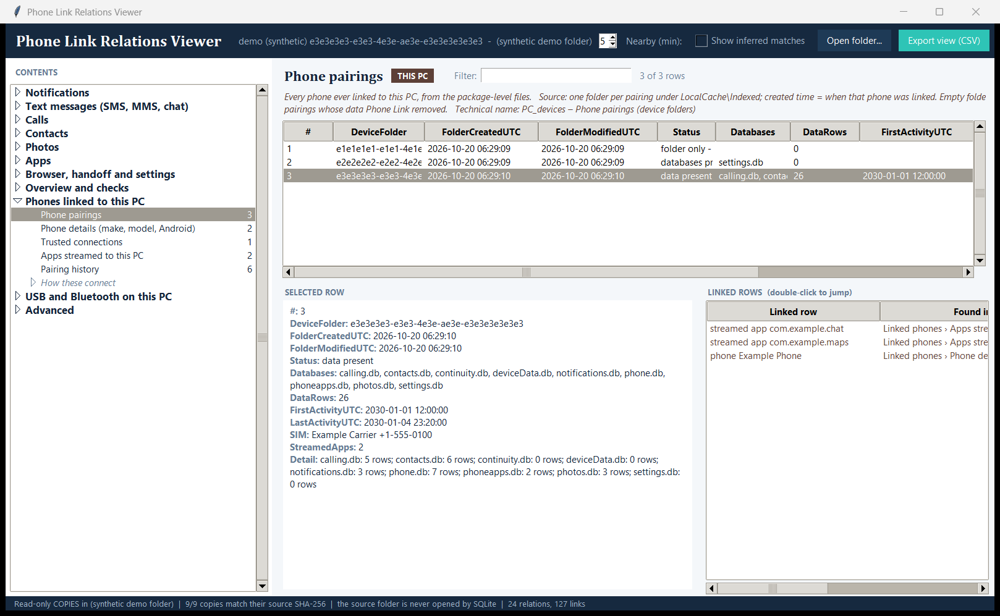
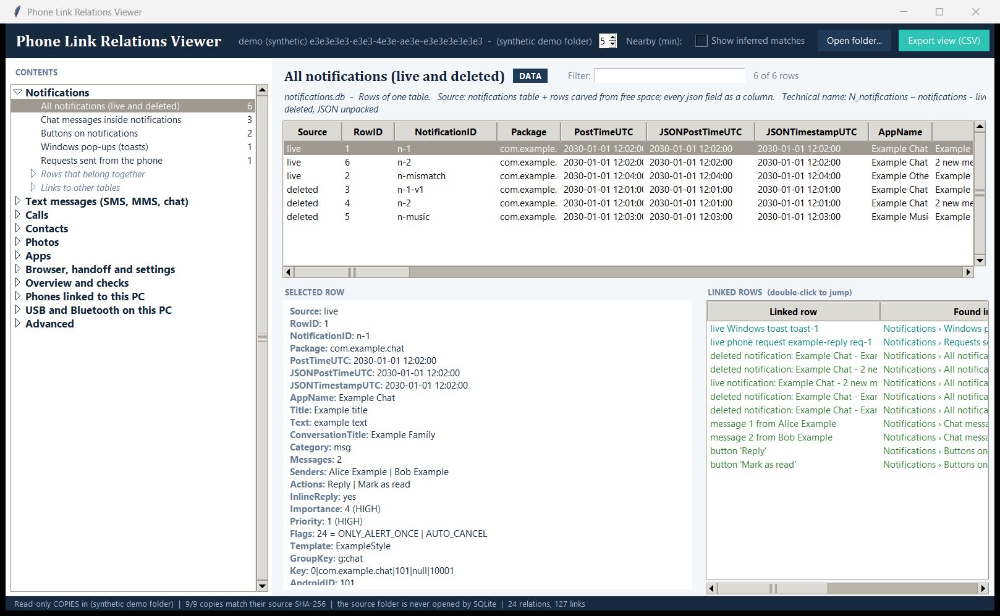
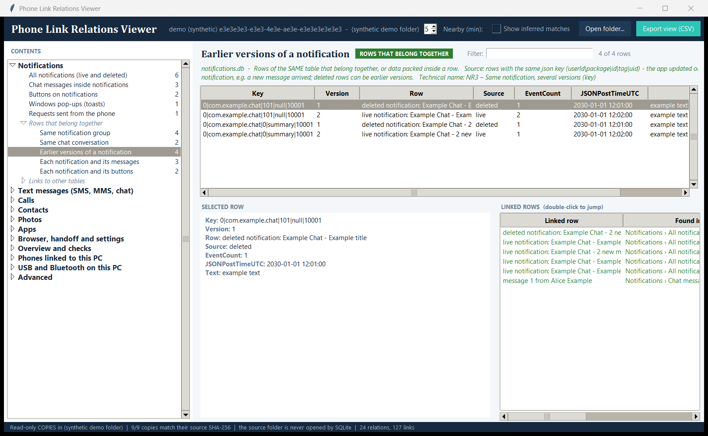
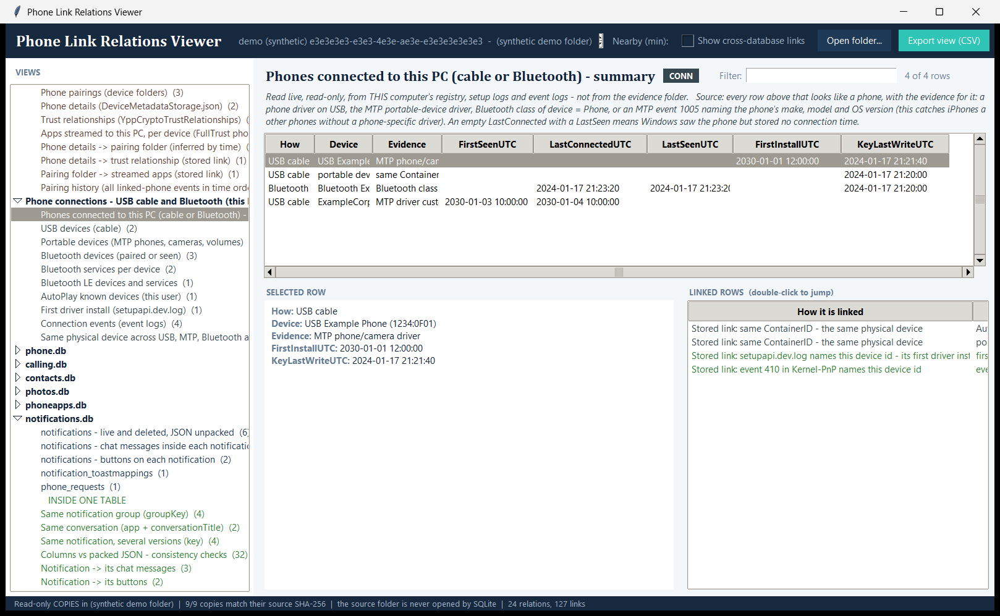
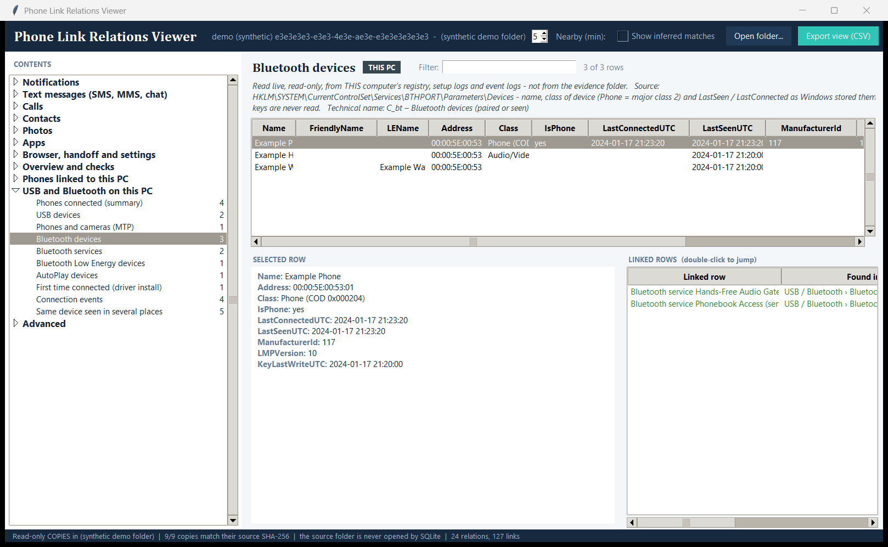
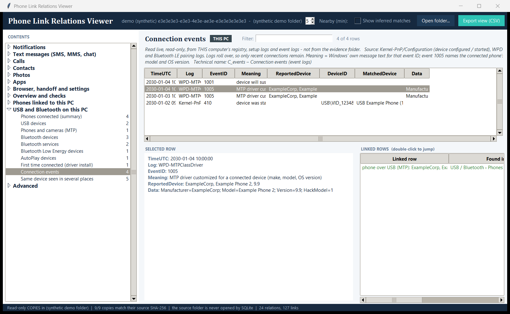
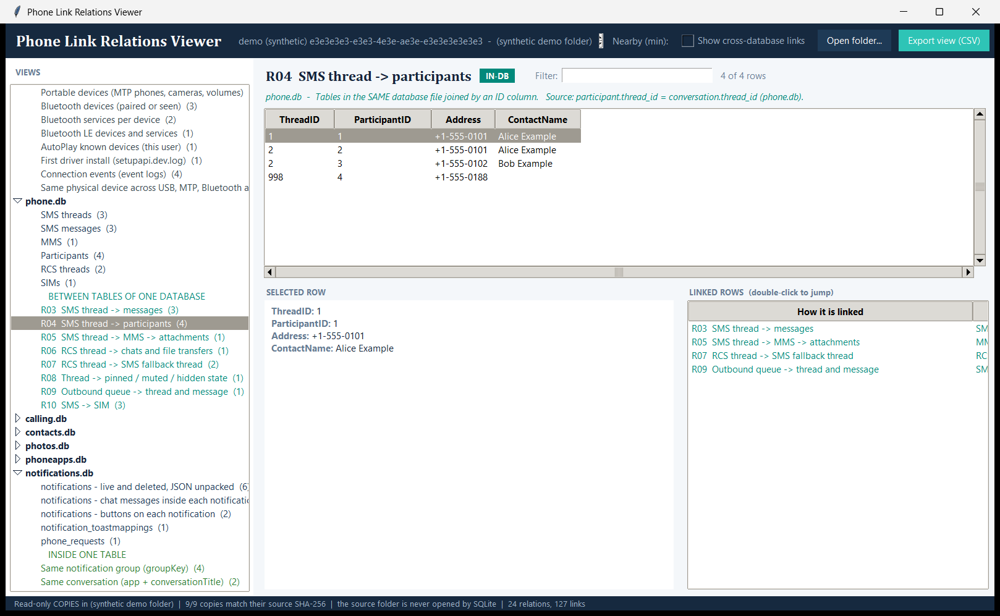
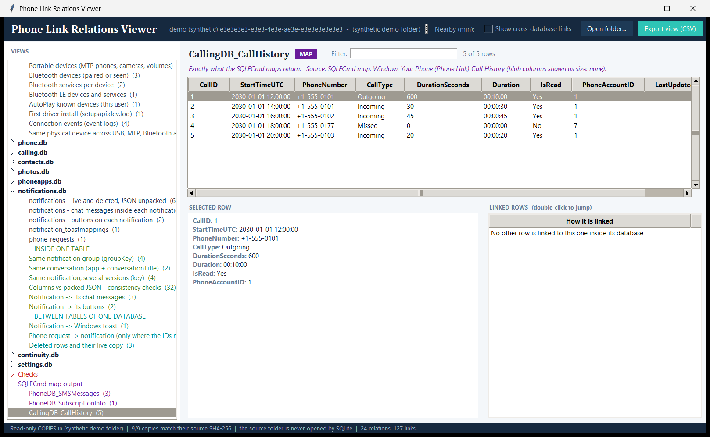

# Phone Link forensics

[](https://github.com/whitedevil1026/phone-link-forensics/actions/workflows/tests.yml)

Forensic tooling for **Microsoft Phone Link** (formerly *Your Phone*), the Windows app that mirrors an Android phone's messages, calls, photos, notifications and apps onto a PC. It also covers the other ways a phone leaves traces on a PC: **USB cable** and **Bluetooth**.

The repository has two parts:

| Part | What it is | For |
|---|---|---|
| [`maps/`](maps) | Five **SQLECmd maps** (one fix, four new) | Running inside Eric Zimmerman's [SQLECmd](https://github.com/EricZimmerman/SQLECmd) / KAPE to turn the Phone Link databases into CSV |
| [`viewer/`](viewer) | A **desktop viewer** (Python, standard library only) | Exploring the databases, recovering deleted rows, and following how rows relate to each other |

All screenshots and test data in this repository are **synthetic** (example names, `555-01xx` numbers, documentation-range addresses). No real phone's data is included.

---

## Contents

- [Screenshots](#screenshots)
- [Quick start](#quick-start)
- [The viewer](#the-viewer)
  - [How evidence is handled](#how-evidence-is-handled)
  - [The window](#the-window)
  - [Linked phones (this PC)](#linked-phones-this-pc)
  - [Phone connections: USB cable and Bluetooth (this PC)](#phone-connections-usb-cable-and-bluetooth-this-pc)
  - [Where Windows stores phone connection traces](#where-windows-stores-phone-connection-traces)
  - [The Phone Link databases](#the-phone-link-databases)
  - [notifications.db in detail](#notificationsdb-in-detail)
- [The SQLECmd maps](#the-sqlecmd-maps)
- [Tests](#tests)
- [Limitations](#limitations)

---

## Screenshots

The **Contents** list on the left uses plain names grouped by topic, with each view's row count on the right. Every screenshot uses the synthetic demo data.

**Linked phones**: every phone ever linked to this PC through Phone Link, including pairings whose data was removed. The panel on the right shows how a pairing connects to its phone details and streamed apps.



**Notifications, live and deleted**: rows recovered from free pages are marked `deleted`. The packed JSON is unpacked into columns, and every linked row (group, conversation, older versions, chat messages, buttons, Windows toast, phone request) is listed on the right.



**Rows that belong together**: *Earlier versions of a notification*. Here a deleted row is the earlier version of a live one.



**Phones connected by cable or Bluetooth**: one summary of every phone trace on this PC, with the evidence for each.



**Bluetooth devices**: name, class of device, LastSeen and LastConnected, linked to the services the device offered.



**Connection events**: event-log entries with Windows' own meaning for each event ID. MTP event 1005 names the connected phone's make, model and OS version.



**Links to other tables**: *Conversation → its people*, under Text messages (joined inside `phone.db`).



**SQLECmd map output**: exactly what the SQLECmd maps return for the same database.



---

## Quick start

Requirements: **Python 3.8+** on Windows (Tkinter ships with Python). Nothing to install for the viewer.

```bash
# 1. Try it on synthetic data - nothing real is read
python viewer/plmapview.py --demo

# 2. One device folder (for example a collected evidence folder)
python viewer/plmapview.py --input "<...>\LocalCache\Indexed\<device GUID>\System\Database"

# 3. Everything on this PC: all Phone Link pairings, plus phones connected by USB cable or Bluetooth
python viewer/plmapview.py --input "%LOCALAPPDATA%\Packages\Microsoft.YourPhone_8wekyb3d8bbwe"

# 4. Add the cable / Bluetooth section explicitly for any input
python viewer/plmapview.py --input "<folder>" --this-pc
```

Phone Link's default location on a PC:

```
%LOCALAPPDATA%\Packages\Microsoft.YourPhone_8wekyb3d8bbwe\LocalCache\Indexed\<device GUID>\System\Database\
```

That folder holds `phone.db` (SMS, MMS, RCS), `calling.db` (calls), `contacts.db`, `photos.db` (photo index), `phoneapps.db` (installed apps), `notifications.db`, `continuity.db`, `deviceData.db` (wallpaper) and `settings.db`, each with its `-wal` and `-shm`.

---

## The viewer

### How evidence is handled

- **Copies only.** The input folder is copied to a temporary folder first: every `.db` with its `-wal` and `-shm`, plus the package files for *Linked phones*.
- **A steady snapshot.** A live database can change while its `.db`, `-wal` and `-shm` are copied one after another. The `.db` and `-wal` are hashed before and after each set, and a set that changed is copied again (up to 3 tries). A source that never settles is still loaded, with a warning in the status bar, because a busy live source cannot be frozen without administrator rights. Its rows in **Copies and hashes** say `source changed during copy`, show no source hash (there is none to claim) and give the copy's own hash instead. Treat that copy as possibly mixing two moments.
- **Every copy of a steady source is re-hashed (SHA-256) against its source.** A mismatch stops the load, and the bad copy is removed.
- **Read-only.** Copies are opened with SQLite `mode=ro` and `query_only`. The source folder is never opened by SQLite.
- **Deleted rows are carved from the copy** (`plcarve.py`): free pages, freeblocks, page slack and WAL frames. A record is recoverable only while its header survives, and a typical single-row delete overwrites it, so most recoveries come from whole free pages, page slack and WAL frames. A long value is only partly on the page itself (the rest is on overflow pages, which are not read), so a carved value cut at that boundary is marked `value cut - rest was on overflow pages (not read)` instead of looking complete. If the live rows of a table cannot be read, its carved rows are labelled `unknown - live rows unreadable` rather than `deleted`.
- **Cleanup.** Copies are deleted when the window closes. If a copy cannot be removed, the viewer says so and shows the path. On start it reports copy folders left by earlier runs.
- **Secrets are never read.** Not read: the Bluetooth link keys, `PlatformEncryptedKeyStorage.json` and certificate bodies (only counted).
- **Folder links are not followed.** When the Phone Link package is copied, a symlink or junction is skipped, not followed, and is listed in **Linked-phone copies and hashes** as `skipped - symlink or junction, not followed`.
- **Read-only access to the live PC.** The cable / Bluetooth section reads the live registry and logs, and changes nothing.

### The window

- **Left: Contents.** Plain-English names grouped by topic, each with its row count on the right:
  - **Notifications** (open when the window starts), **Text messages (SMS, MMS, chat)**, **Calls**, **Contacts**, **Photos**, **Apps**, **Browser, handoff and settings**
  - **Overview and checks**: the timeline, calls and texts per person, and the checks
  - **Phones linked to this PC** and **USB and Bluetooth on this PC**
  - **Advanced**: the SQLECmd map output, and the copies with their hashes
  - Inside a topic the data comes first. **Rows that belong together**, **Links to other tables** and **Matched from other files (inferred)** are folded sub-headings. A greyed name has no rows.
  - Opening a view puts its technical name (view code, database and table) in the banner, so nothing technical is hidden.
- **Middle: the table.** Sortable columns and a filter box. The banner above it says what the view is and where its data comes from.
- **Bottom left: the selected row**, all fields. For a notification the raw JSON is shown underneath.
- **Bottom right: linked rows.** Each line shows *which* row is linked, *where* it is found (topic › view), *how* it is linked (in plain words), and whether it's in the same table, another table of the same database, or another database. **Double-click a line to jump to that row.**
- **Top bar:**
  - **Show inferred matches**: off by default, because matches across database files are the tool's inferences.
  - **Nearby (min)**: the window used for "events close in time".
  - **Open folder…** and **Export view (CSV)**. The export is written to a temporary file and moved into place, so a failure never leaves a half-written file. It is Excel-safe: a cell that starts with `=`, `+`, `-`, `@`, a tab or a line break gets a leading `'` so Excel shows it as text, unless the whole cell is a plain number (`-5`, `3.14`, `+15550100`); a phone number written as `+1 555 0100` does get the `'`. Binary values are written as `<N bytes>`.
- **Keys and mouse.** Enter on a linked row jumps to it, like a double-click. The selected-row text is read-only (you can select and copy it). Unticking **Show inferred matches** removes the inferred views from the Contents list and the inferred lines from the linked rows, and leaves an inferred view if one is open.

Every link carries its basis, colour-coded:

| Kind | Colour | Meaning |
|---|---|---|
| Inside one table | green | Rows of the same table that belong together, or data packed inside one row |
| Between tables of one database | teal | Tables in the same `.db` joined by an ID column |
| Stored link | (in the text) | The ID is written in the data itself |
| Inferred | orange / labelled | The tool's own join, for example by time or phone number. It is never stored on the device |
| Checks | red | Rows whose partner is missing, or counts that disagree |

### Linked phones (this PC)

Every phone that has ever been linked to the PC through Phone Link, **including phones whose data Phone Link has since removed**. Open the package folder to see it.

| View | Source | What it shows |
|---|---|---|
| Phone pairings | `LocalCache\Indexed\<GUID>\` | One row per pairing, oldest first. The folder's creation time is when that phone was linked. Status: *data present* / *data in other tables* (rows only in tables the viewer does not know; the tables are named in Detail as `table: rows`, and Phone Link's own bookkeeping tables are not counted) / *databases present but empty* / *unreadable database* / *files present but no databases* / *folder only - its data was removed*. Also: databases left, row counts, first/last activity, SIM, apps streamed |
| Phone details | `LocalCache\DeviceMetadataStorage.json` | Per hardware ID: display name, manufacturer, model, Android version, Phone Link app version, capabilities, linked/enabled, registration and last-seen times. A hardware ID without details is a phone that was unlinked |
| Trust relationships | `LocalCache\YppCryptoTrustRelationships` | Partner device, trust type, last access, key expiry, Microsoft account ID (MsaCid) |
| Apps streamed per device | `LocalCache\Indexed\FullTrust\phone_apps.db` | `hosted_app_ids`: one row per app a phone streamed to the PC |
| Pairing history | all of the above | Every linked-phone event in time order |
| Linked-phone copies and hashes | the files above | Each package file copied, with its hash check; symlinks and junctions are listed as skipped |

How they connect:
- **Stored:** a trust relationship's partner ID is `<prefix>_<metadata Id>`.
- **Stored:** `hosted_app_ids.device_id` is the pairing folder's name.
- **Inferred by time:** the phone details are matched to the closest pairing folder created within 10 minutes after registration.

### Phone connections: USB cable and Bluetooth (this PC)

Phones that reached the PC **without** Phone Link. This section reads the **live** registry, setup logs and event logs of the computer the viewer runs on, so it describes *that* PC, never an evidence folder from another one. It appears only with `--this-pc`, or when `--input` is this PC's own Phone Link folder.

| View | What it shows |
|---|---|
| Phones (summary) | Every trace that looks like a phone, with the evidence: a phone driver on USB, the same ContainerID as a USB phone, Bluetooth class of device = Phone, or an MTP event 1005 naming the phone's make, model and OS version. Event 1005 also catches iPhones, which have no phone-specific driver. **PhysicalDevice** groups the rows of one physical device (ContainerID, else Bluetooth address, else device ID) and **Serial** is the USB serial number when there is one. One phone still spans several rows; the column makes them groupable. An event-1005 row only knows make, model and OS, so it says *may be more than one phone* |
| USB devices | Name, manufacturer, VID/PID, serial, driver, ContainerID, first install, key last-write time |
| Portable devices (MTP) | The name shown in *This PC* when a phone was plugged in |
| Bluetooth devices | Name, class of device, manufacturer ID, LMP version, VID/PID, **LastSeen**, **LastConnected** |
| Bluetooth services | Each profile a device offered: Hands-Free, Phonebook Access, Message Access, A2DP, … |
| Bluetooth LE | Low Energy devices and the GATT services they offered |
| AutoPlay known devices | The label AutoPlay showed this Windows user |
| First driver install | The earliest time each device ID was installed, across the current and rotated setup logs |
| Connection events | Event-log entries with Windows' own meaning for each ID. At most the newest 10,000 events of each log are read; the view's banner states the cap and says when it was reached |
| Locations this account could not read | Registry keys, logs or event channels that were denied or failed to read, so you can tell an empty result from a failed one |

Stored links between them:
- **Same physical device:** USB, MTP, Bluetooth and AutoPlay entries that share a ContainerID.
- **Bluetooth device → its services:** the address is in the service's instance ID.
- **Device → its first install and its events:** the device ID is in the log line or event.

### Where Windows stores phone connection traces

Checked on Windows 11 with a standard (non-admin) account. *Read by the tool* says whether the viewer uses the location.

**USB cable**

| Location | What is stored | Readable without admin | Read by the tool |
|---|---|---|---|
| `HKLM\SYSTEM\CurrentControlSet\Enum\USB\VID_xxxx&PID_yyyy\<serial>` | One entry per USB device: VID/PID, **serial number** (the key name), description, manufacturer, driver service, `ContainerID` | yes | yes |
| `…\Enum\USB\…\<serial>\Properties\{83da6326-97a6-4088-9453-a1923f573b29}\0064` / `0065` / `0066` / `0067` | Install date / first install date / last arrival (connected) / last removal. `0067` exists only after the device was removed | **no** (SYSTEM only) | no |
| `HKLM\SYSTEM\CurrentControlSet\Enum\SWD\WPDBUSENUM\<id>` | The phone as a portable device (MTP): name, manufacturer, `ContainerID` | yes | yes |
| `HKLM\SOFTWARE\Microsoft\Windows Portable Devices\Devices\<id>` | The portable device's display name | yes | yes |
| `HKLM\SYSTEM\CurrentControlSet\Control\DeviceContainers\{ContainerID}` | One container per physical device. Every `ContainerID` in the entries above points to one. Windows usually keeps a phone's USB and Bluetooth sides in separate containers. Its `Properties` subkey is SYSTEM only | yes (`BaseContainers`) | via `ContainerID` |
| `HKCU\Software\Microsoft\Windows\CurrentVersion\Explorer\AutoplayHandlers\KnownDevices\<id>` | Per Windows user: the label AutoPlay showed, `ContainerID`, icon | yes | yes |
| `HKLM\SYSTEM\CurrentControlSet\Enum\USBSTOR` | Only if the phone appeared as a storage drive | yes | listed with USB devices |
| `C:\Windows\INF\setupapi.dev.log` and rotated `setupapi.dev.<date>.log` | First time a driver was installed for a device ID (local time) | yes | yes |
| Event log `Microsoft-Windows-Kernel-PnP/Configuration` | 400 configured · 410 started · 411 problem starting · 420 deleted · 430 requires further installation · 442 settings not migrated from a previous Windows install | yes | yes |
| Event log `Microsoft-Windows-WPD-MTPClassDriver/Operational` | 1000 MTP driver started · 1001–1003 idle / suspend / resume · 1004 operation cancelled · **1005 driver customized for the connected device (make, model, OS version)** · 1006 driver failed to start | yes | yes |

**Bluetooth**

| Location | What is stored | Readable without admin | Read by the tool |
|---|---|---|---|
| `HKLM\SYSTEM\CurrentControlSet\Services\BTHPORT\Parameters\Devices\<MAC>` | Name, class of device (`COD`; major class 2 = phone), manufacturer ID, LMP version, VID/PID, **`LastSeen`**, **`LastConnected`** (`0` = never recorded) | yes | yes |
| `HKLM\SYSTEM\CurrentControlSet\Services\BTHPORT\Parameters\Keys\<PC MAC>\<device MAC>` | Pairing (link) keys | **no** (SYSTEM only) | **never**, these are secrets |
| `HKLM\SYSTEM\CurrentControlSet\Enum\BTHENUM\{service}_…\<…&MAC_…>` | One entry per profile the device offered | yes | yes |
| `HKLM\SYSTEM\CurrentControlSet\Enum\BTHLE` and `…\Enum\BTHLEDevice` | Bluetooth Low Energy devices and their GATT services | yes | yes |
| Event log `Microsoft-Windows-Bluetooth-BthLEPrepairing/Operational` | Bluetooth LE pairing (often empty) | yes | yes |

**Phone Link**

All under `%LOCALAPPDATA%\Packages\Microsoft.YourPhone_8wekyb3d8bbwe\LocalCache\`:

| Location | What is stored |
|---|---|
| `Indexed\<GUID>\System\Database\` | One folder per linked phone, with its databases. The folder's creation time is when the phone was linked |
| `DeviceMetadataStorage.json` | Phone name, maker, model, Android version, linked and last-seen times |
| `YppCryptoTrustRelationships` | Trust with the phone: last access, key expiry, Microsoft account ID |
| `Indexed\FullTrust\phone_apps.db` | Apps the phone streamed to the PC |

A registry key's **last-write time** is shown as a lead, not as a documented connection time.

### The Phone Link databases

Each database is a node in the window. It holds its tables, the relations inside a table, and the relations between its tables:

| Database | Relations between its tables |
|---|---|
| `contacts.db` | Contact -> numbers, emails, addresses, dates, URLs (`contact_id`); deleted contact details (tombstones written by triggers) |
| `phone.db` | SMS thread -> messages / participants / MMS -> attachments; RCS thread -> chats and file transfers; RCS thread -> SMS fallback thread; thread -> pinned / muted / hidden state; outbound queue; SMS -> SIM |
| `phoneapps.db` | Installed app -> recent app / Windows counterpart (`package_name`) |
| `notifications.db` | See below |

**Checks:**
- **Orphans:** participants or messages whose thread no longer exists, contact details whose contact is gone, and RCS threads without their SMS fallback.
- **Sync completeness:** each feed's sync bookmark (`content_sequence`) compared with the rows present.

**Across databases** (hidden until you tick the box, because these are inferences):
- calls / SMS / threads -> contacts, by the last 10 digits of the number;
- calls -> SIM;
- one profile per person across calls and SMS;
- notifications and settings -> installed apps;
- photo taken during a call;
- events close in time;
- one unified timeline.

**SQLECmd map output** shows the output of all nine Phone Link maps (the five here and four stock ones) for the same copies.

### notifications.db in detail

Phone Link deletes a notification when it is dismissed, so the live table is often empty. The rows usually survive on free pages, so the viewer carves them.

| View | What it shows |
|---|---|
| notifications | Live rows **and carved deleted rows** (Source = deleted, with page and offset). All 36 fields of the `json` column become columns. `flags`, `importance`, `priority` and the Android `key` (user / package / id / tag / uid) are decoded as the Android API defines them |
| chat messages | `messages[]` with `senderNames[]`: who wrote each message inside one notification |
| buttons | `notificationActions[]`; *InlineReply* means the notification could be answered from the PC |
| notification_toastmappings, phone_requests | Live and carved rows |

Relations inside the table:
- **Same group** (`groupKey`; the summary row carries `FLAG_GROUP_SUMMARY`).
- **Same conversation** (app + `conversationTitle`).
- **Several versions of one notification** (same `key`).
- **Plain columns vs json:** consistency checks.

Relations between tables:
- **Notification -> Windows toast.**
- **Phone request -> notification**, only where the IDs are identical.
- **Deleted row -> its live copy.**

`isGroup` in the json means "belongs to an app-defined group" (`groupKey` differs from the notification's own `key`), not "is the group summary". That reading was measured on a small sample, so treat it as inferred.

---

## The SQLECmd maps

The stock SQLECmd map set no longer parses some Phone Link databases and has no map at all for others.

- **`photos.db` is silently skipped by the stock map.** Current Phone Link builds no longer have the `photo` table, so `Windows_YourPhone_PhotosDB.smap` v1.1 stops matching and SQLECmd lists the database as having no map. v1.2 here matches by the columns its query actually reads.
- **Four databases had no map:** `calling.db`, `continuity.db`, `phoneapps.db`, `deviceData.db`.

| Map | Database | What you get |
|---|---|---|
| `Windows_YourPhone_PhotosDB.smap` (v1.2) | `photos.db` | Photo index with taken / seen / sync times; thumbnails exported as JPEG |
| `Windows_YourPhone_CallingDB.smap` | `calling.db` | Calls: number, direction, start time, duration, SIM, read flag, raw times |
| `Windows_YourPhone_ContinuityDB.smap` | `continuity.db` | Phone browser history offered to the PC; cross-device app context |
| `Windows_YourPhone_PhoneAppsDB.smap` | `phoneapps.db` | Installed apps (icons as PNG), recent apps, Android ↔ Windows app links |
| `Windows_YourPhone_DeviceDataDB.smap` | `deviceData.db` | The linked phone's wallpaper image |

The stock maps for `contacts.db`, `phone.db`, `notifications.db` and `settings.db` still match current builds and are not duplicated here.

**Use**

1. Copy the `.smap` files into SQLECmd's `Maps` folder, or point `--maps` at this repo's `maps` folder.
2. **Work on copies.** SQLECmd opens databases read-write and writes `-shm`/`-wal` files beside them. Collect each `.db` together with its `-wal` and `-shm`, because recent rows can exist only in the `-wal`.
3. Run it:
   ```
   SQLECmd.exe -d <copied folder> --hunt --maps <maps folder> --csv <out>\csv --blobdir <out>\blobs
   ```

**Design rules**

- **A map only matches a database its queries can run on.** Every IdentifyQuery checks the exact columns the queries read, and that they are real tables: a planted view does not match.
- **Times are never invented.** A timestamp of 0, a negative value, text, or a value past year 9999 gives an empty time, never 1601-01-01. Raw columns keep the stored value as text.
- **Nothing is dropped or duplicated.** Joins are pre-grouped, so one source row gives exactly one output row.
- **Every blob is written, once.**
  - File names come from a unique key, because SQLECmd otherwise cuts names to 50 characters and silently overwrites duplicates.
  - Blob columns are always real BLOB values, so SQLECmd's CSV columns stay aligned.
- **Unconfirmed epochs are labelled.** They are converted by size, with the raw value kept beside them.
- **Fast on large databases.** In a stress test, 1,000,000 calls, 500,000 photos and 20,000 apps with icons ran through SQLECmd in about 85 s.

**SQLECmd behaviours to know** (not fixable in a map)

- It writes `-shm`/`-wal` files beside its input, so run it on copies.
- It skips a database that is locked or held open by another process, and still exits with code 0.
- It ignores a `-wal` whose header doesn't match the database, without warning.
- It has no query timeout, so a crafted view can make it run forever.
- It converts a value whose stored type differs from the column's declared type: text in an INTEGER column becomes 0 or its leading number. The `*Raw` columns are cast to text so the stored value survives.
- CSV cells hold values exactly as stored, including leading `=` `+` `-` `@`. Open the CSVs as text or in Timeline Explorer, not by double-clicking them into Excel.

---

## Tests

All tests use synthetic data. GitHub Actions runs them on every push (badge at the top).

```bash
pip install pyyaml yamllint
yamllint -c .yamllint maps
python tests/run_tests.py                          # maps: emulator of SQLECmd's matching, answer-key data
python tests/run_tests.py --sqlecmd C:\Tools\SQLECmd.exe   # maps: also the real SQLECmd
python tests/stress.py C:\Tools\SQLECmd.exe        # maps: large synthetic databases
python viewer/test_plevidence.py                   # viewer: copying, snapshot stability, carving, read-only opens
python viewer/test_plrelate.py                     # viewer: relations, planted answers
python viewer/test_pldevices.py                    # viewer: linked phones
python viewer/test_plconnect.py                    # viewer: USB cable / Bluetooth (synthetic registry)
python viewer/test_plmapview.py                    # viewer: the window itself
```

See [docs/TESTING.md](docs/TESTING.md) for how the maps were tested.

---

## Limitations

- Tested against Windows 11 Phone Link builds from 2026 with linked Android phones. A future Phone Link build may change the schema. The maps' IdentifyQueries then fail to match rather than give wrong output, and the viewer shows what it finds.
- `continuity.db` and `pcapp_data` were empty on the test systems, so those queries are tested on synthetic rows, and their epochs are inferred by size.
- Carving recovers what SQLite left in free space. A recovered row is matched by its record shape, not proven, and each one shows the page and offset it came from.
- The USB install / first / last-arrival times under `Properties` need SYSTEM rights and are not read. The key last-write time is a lead, not a connection time.
- iPhone pairings with Phone Link were not tested.

## Related

Capability Access Manager (camera, microphone and location usage) maps are a separate tool: [sqlecmd-maps-capabilityaccessmanager](https://github.com/whitedevil1026/sqlecmd-maps-capabilityaccessmanager).

## Credits

`Windows_YourPhone_PhotosDB.smap` builds on Andrew Rathbun's original map. MIT licence.
